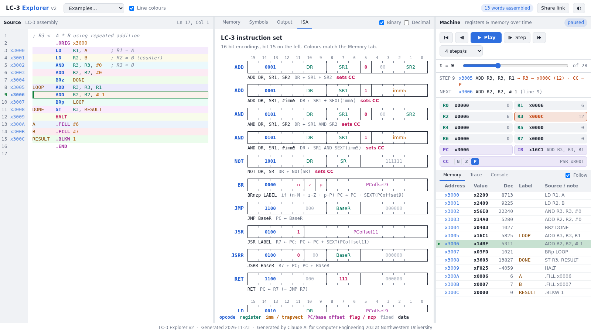

# LC-3 Explorer: Assembler and Simulator for the LC-3 Computer

LC-3 Explorer is a single web page for LC-3 assembly programming.
The page assembles your LC-3 program into machine code.
The page also simulates the LC-3 computer.
During the simulation, the page shows each change to the memory and to the registers.

**Open the page in your browser:** [LC-3 Explorer](https://rawcdn.githack.com/caslab-code/ce203-lc3-explorer/f8a924e623b629ca540e215fbb8fdd7ac3a43866/lc3-explorer.html)

You do not need to download a file to use this link.

> **Note:** Before the page opens, githack shows a warning page with the title "One more step". The warning tells you that githack does not review the content of the page. This is normal. Click **Open the page** to continue.

## Function

- The page changes LC-3 assembly code into 16-bit machine words.
- The page shows errors and warnings for each line of code.
- The page simulates the LC-3 computer. It runs the program one instruction at a time.
- The page shows the values in the registers and in the memory at each step.
- The page shows the changes that each instruction makes.
- You can move forward and backward through the steps of the program.

## The three panels

The page has three panels. The panels are side by side.

### 1. Source panel (left)

You write your LC-3 assembly program in this panel.

- The panel shows the line numbers and the memory address of each line.
- The panel shows the parts of each line in different colors.
- The panel shows a red mark on each line that has an error.
- A list below the panel shows all errors and warnings. Click an item to go to its line.
- When the program runs, a green mark shows the next line to execute.

### 2. Assembly panel (center)

This panel shows the result of the assembly. The panel has three tabs:

- **Memory**: This tab shows each memory address and its 16-bit value. The value is in hexadecimal and in binary. Colors show the fields of each instruction, for example the opcode, the registers, and the offset. Put the mouse pointer on the binary value to see a description of each field.
- **Symbols**: This tab shows each label and its address.
- **Output**: This tab lets you download the program as `.obj`, `.hex`, `.bin`, and `.sym` files.

When you click a line in the source panel, the related memory words get a highlight. When you click a memory word, the related source line gets a highlight.

### 3. Machine panel (right)

This panel simulates the LC-3 computer. It shows the state of the computer at each step.

- **Controls**: Use these buttons to run the program:
  - **Play** runs the program. **Pause** stops it.
  - **Step** executes one instruction.
  - **Step back** goes back one instruction.
  - **Reset** goes back to the start.
  - **Run to end** goes to the last step.
  - The speed menu sets the number of steps each second.
- **Timeline**: Move the slider to go to a step. The panel shows the step number.
- **Registers**: The panel shows the 8 general purpose registers R0 to R7. At the start, all registers have the value 0. The panel also shows the PC, the IR, and the condition codes (N, Z, P) in a different color. A register that changes during a step gets an orange highlight.
- **Memory tab**: This tab shows the memory of the program and the other addresses that the program uses. A green arrow shows the address in the PC. An orange highlight shows a word that the program writes. A blue highlight shows a word that the program reads.
- **Trace tab**: This tab shows a list of all steps. Each step shows the instruction and its changes. Click a step to go to that step.
- **Console tab**: This tab shows the text that the program prints. Type the keyboard input for the program in the box. The GETC and IN instructions read this input.

## Procedure

### Run the page without a download

1. Open this link in a web browser: https://rawcdn.githack.com/caslab-code/ce203-lc3-explorer/f8a924e623b629ca540e215fbb8fdd7ac3a43866/lc3-explorer.html
2. A warning page with the title "One more step" opens. Click **Open the page**.
3. Do the steps in "Use the page" below.

### Run the page from a downloaded file

1. Download the file `lc3-explorer.html`.
2. Open the file in a web browser.
3. Do the steps in "Use the page" below.

### Use the page

1. Write your LC-3 program in the source panel. You can also select a program from the **Examples** menu.
2. Make sure that the program has no errors.
3. Push the **Play** button in the machine panel to run the program.
4. Push the **Step** button to execute one instruction.
5. Look at the registers and the memory to see the changes.

The downloaded file does not need a server or an internet connection.

## Keyboard shortcuts

These shortcuts operate the machine panel. They do not operate when you type in the source panel.

| Key | Action |
| --- | --- |
| Space | Play or pause |
| Right arrow | Step forward |
| Left arrow | Step back |
| Home | Go to the start |
| End | Go to the end |

## Notes on the simulation

- The simulation does not load an operating system. The page executes each TRAP routine (GETC, OUT, PUTS, IN, PUTSP, HALT) in one step.
- A TRAP instruction puts the return address in R7. This is the same as on the real LC-3.
- The LEA instruction does not change the condition codes. This is the same as in lc3tools.
- The simulation stops after 10,000 steps. This prevents an infinite loop.

## Development

The code was developed with Claude AI.

## License

The code is in the public domain. The license is [The Unlicense](LICENSE).
Anybody can use, copy, change, sell, and share the code for any purpose.
You do not need to ask for permission or give credit.
The code has no warranty.
